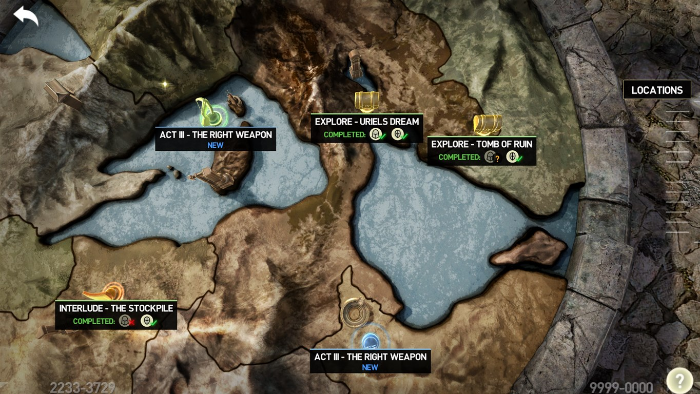
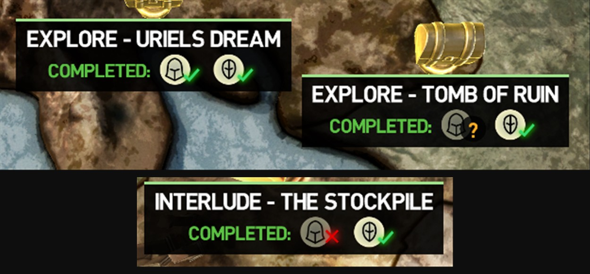
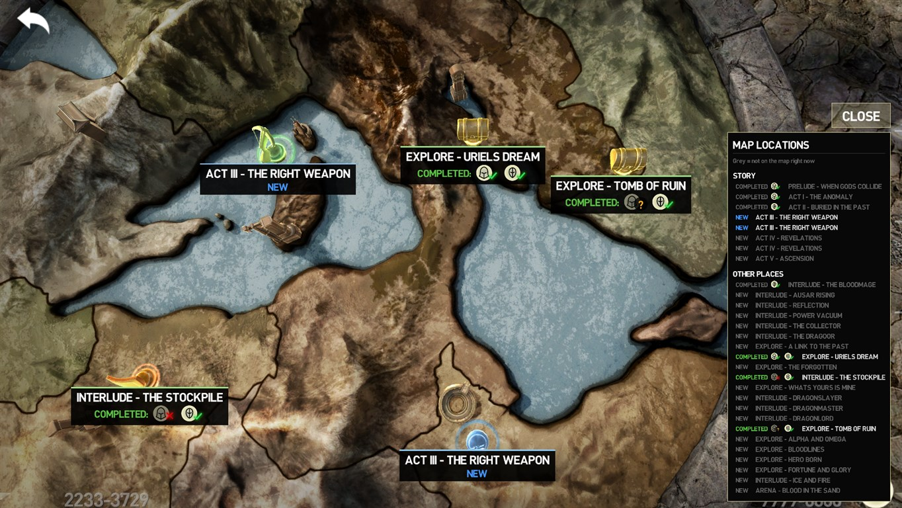
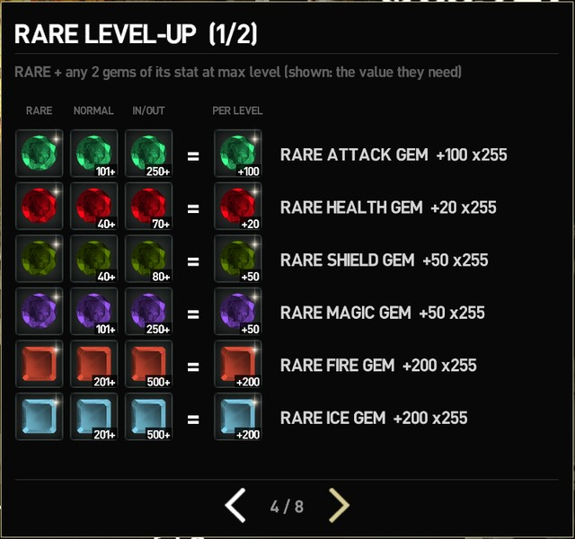
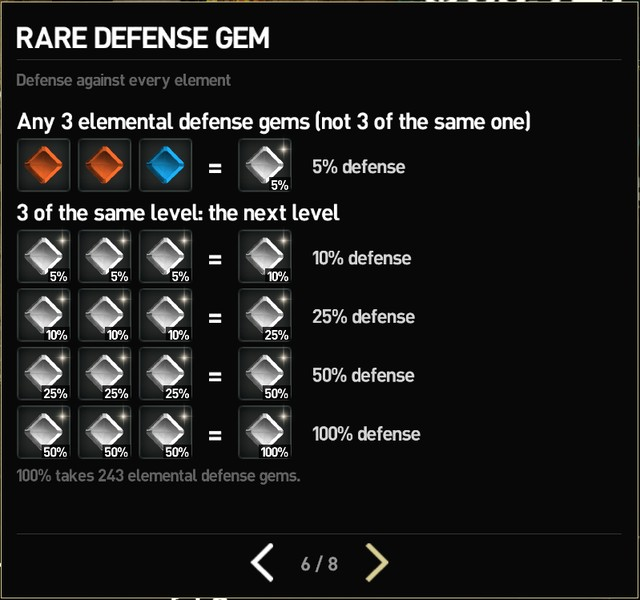
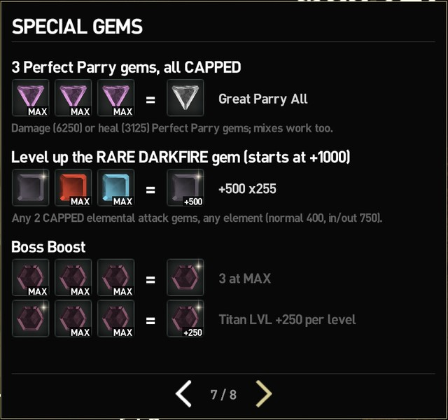

# Infinity Blade III PC – QoL mod

Small unofficial quality-of-life mod for the Infinity Blade III PC port (v1.0.0).

## Install

1. Download **`dinput8.dll`** with the green button above.
2. Put it in `InfinityBlade3_v1.0.0\Binaries\Win64` (next to `IB3.exe`).
3. Play.

To uninstall, delete `dinput8.dll` (and the `IB3QoL` files it creates next to it). No game files or saves are changed.

**Steam Deck / Linux:** add `WINEDLLOVERRIDES="dinput8=n,b" %command%` to the launch options.

## Features

- **World map:** every place on the globe gets a label, and the **LOCATIONS** button lists them all with the same labels. What they mean:
  - **NEW**: you have never been there.
  - **VISITED**: you went in but haven't finished it yet.
  - **COMPLETED** with a check on Siris's or Isa's icon: that character has finished it.
  - **COMPLETED** with an X on an icon: that character can still do it but hasn't yet. A character who can't play the place, or can't do it again, gets no icon.
  - **?**: the mod didn't see who finished it (for example, it was before you installed the mod) and the game's save doesn't say. On a character's icon it means that character may or may not have done it.

  When an act or interlude turns into an **EXPLORE** on the same pin, the explore keeps the character marks instead of showing up as **NEW**.

  

  

  

- **Mouse scroll on the map:** scroll the mouse wheel to zoom the globe in and out.

- **"!" on new paths and chests:** path circles and treasure chests you have never taken get the game's own **!** badge, so you can see which routes you haven't tried yet. Each save slot and each playthrough keeps its own marks.

  

- **Gem Cutter & Potion Master:** **RECIPES** button with every recipe, using the game's icons: rare gems and their level-ups, the rare defense gem (5% to 100%), Great Parry, Boss Boost and the Rare Darkfire gem's level-up. Click a result to see what it does. The Potion Master also lists the wiki's potion mixes with their odds, and what each ingredient is good for.

  

    

  

- **Restart any fight mid-game, including the ones the game normally won't let you restart (super bosses, story fights):** hold **R** for 0.3 s during the fight or on the defeat screen. A small **R** tile fills up while you hold it; it only shows while you hold R, so it never gets in the way. After the reload, a fight you started by tapping its circle starts again by itself (unless the circle costs a key), no need to tap it again. It also works after a super boss (Therin and the others) lands the killing blow, while your death scene plays, up to the moment the game would send you to the rebirth. The pause menu's "Restart Battle" is unlocked under the same rules, and the defeat screen's "Replay" no longer disappears after a few deaths. Not available in Hardcore, arena runs, ClashMob, hideout training fights or the Collector's fight, or once you have beaten the boss. Random dragons can't be restarted: the game uses up the dragon and saves as soon as the fight starts, so a restart would make it disappear.

  

- **Gear XP in the pause menu:** the XP bars of everything you have equipped, the same list the game shows after a fight, right next to your character. Outside a fight, click an item to open it in ITEMS.

  

- **Shared skills:** **LOCK PICK II**, **LOCK PICK III** (Isa) and **INGREDIENT PLUS** (Siris) work for both characters once the character they belong to has unlocked them.

- **Sword clash taps on the keyboard:** when blades lock in a parry clash and the game asks you to tap fast, press **F** or **Numpad 5** instead of clicking. Outside a clash the mod does nothing with them (F keeps the game's own weak-point stab).

- **Weapon combo in battle:** your weapon's special combo (the same COMBO arrows the pause menu shows) stays on screen during fights, just right of the block button, also during a super attack.

  

- **Specific weapon combos (bug fix):** some weapons, like Snikt, have combos with diagonal arrows that almost never registered. The game only accepts the flat diagonal for each step, so a slightly steeper swipe counted as up or down, and Numpad 7 / Numpad 3 could never do the up-left / down-right steps. Now a diagonal step also accepts the steeper diagonal next to it; straight steps work as before.

- **Fast forward mastered and level up animations:** click, or hold **Left Shift** (the game's own fast-forward key), to skip the LEVEL UP / MASTERED animation. Left Shift also fast-forwards the battle results. Only the animation is skipped: your stat points and XP are already given.

- **Ready for future game versions:** the mod finds what it needs in the game by itself. If an update changes the game too much, it turns itself off and the game runs normally, instead of crashing.

- **QoL settings in the game:** Options → **QoL** turns each feature on or off.

  

   
