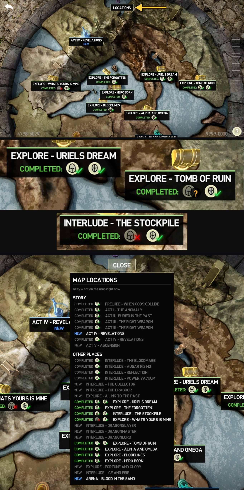
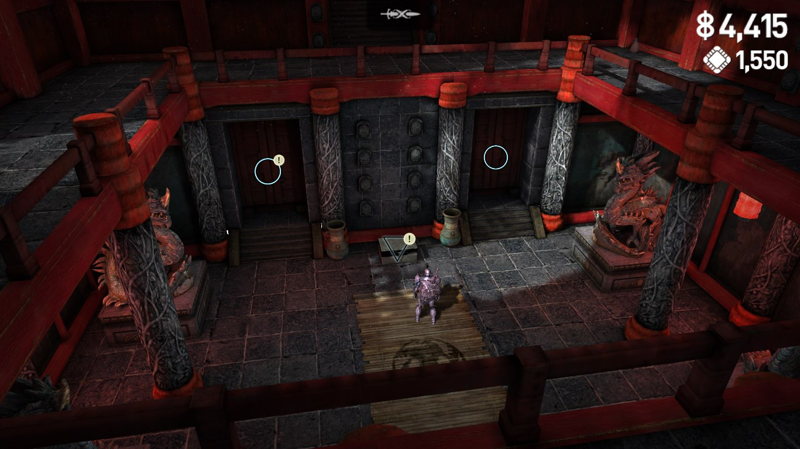
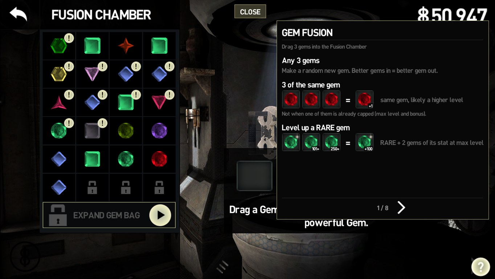
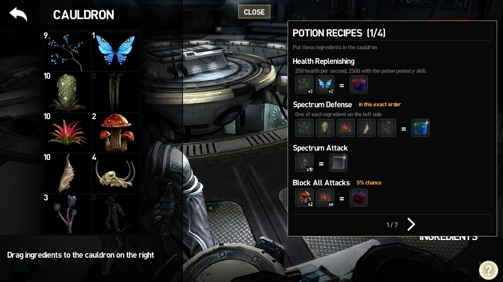
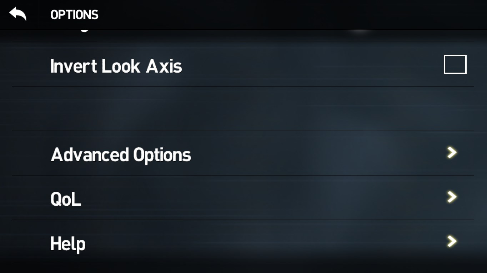
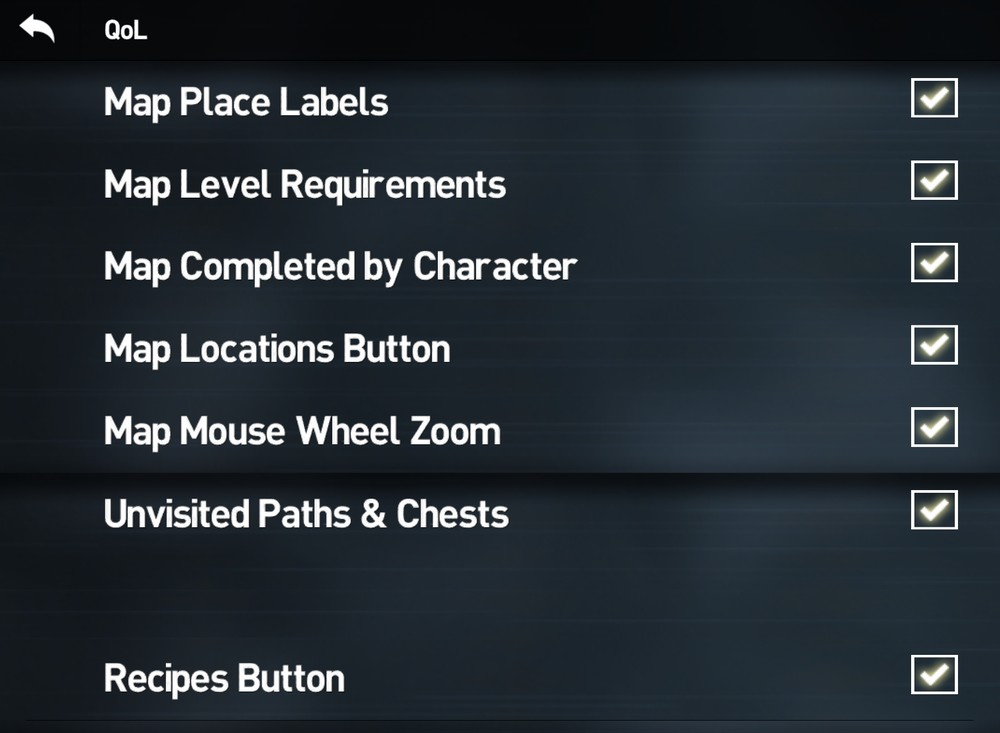
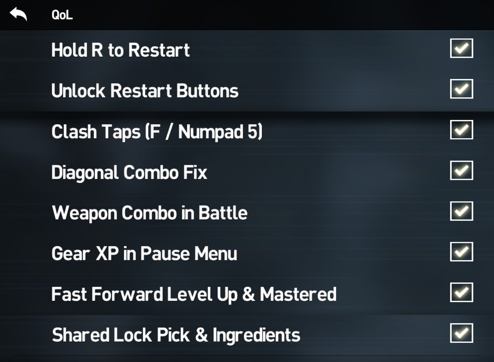

# Infinity Blade III PC – QoL mod

Small unofficial quality-of-life mod for the Infinity Blade III PC port (v1.0.0). The game belongs to ChAIR Entertainment.

## Features

- **World map:** every place shows **NEW**, **VISITED** or **COMPLETED**, and the level you need if yours is too low. **LOCATIONS** button with the full list.
- **Mouse scroll on the map:** scroll the mouse wheel to zoom the globe in and out.
- **"!" on new paths and chests:** path circles and treasure chests you have never taken get the game's own **!** badge, so you can see which routes you haven't tried yet. Each save slot and each playthrough keeps its own marks.
- **Gem Cutter & Potion Master:** **RECIPES** button with every recipe, using the game's icons. Click a result to see what it does. The Potion Master also lists the wiki's potion mixes with their odds, and what each ingredient is good for.
- **Restart any fight mid game, including the ones the game normally won't let you restart (super bosses, story fights):** hold **R** for 0.7 s during the fight or on the defeat screen. The pause menu's "Restart Battle" and the defeat screen's "Replay" are always available too.
- **Sword clash taps on the keyboard:** when blades lock in a parry clash and the game asks you to tap fast, press **F** or **Numpad 5** instead of clicking. These keys do nothing at any other moment.
- **Specific weapon combos (bug fix):** some weapons, like Snikt, have combos with diagonal arrows that almost never registered. The game only accepts the flat diagonal for each step, so a slightly steeper swipe counted as up or down, and Numpad 7 / Numpad 3 could never do the up-left / down-right steps. Now a diagonal step also accepts the steeper diagonal next to it; straight steps work as before.
- **QoL settings in the game:** Options → **QoL** turns each feature on or off.

 

## Install

1. Download **`dinput8.dll`** with the green button above.
2. Put it in `InfinityBlade3_v1.0.0\Binaries\Win64` (next to `IB3.exe`).
3. Play.

To uninstall, delete `dinput8.dll` (and the `IB3QoL` files it creates next to it). No game files or saves are changed.

**Steam Deck / Linux:** add `WINEDLLOVERRIDES="dinput8=n,b" %command%` to the launch options.
