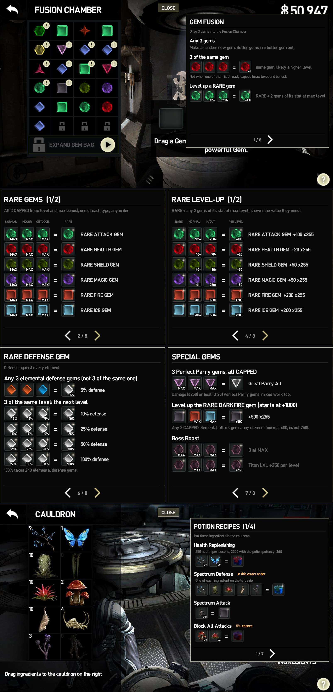
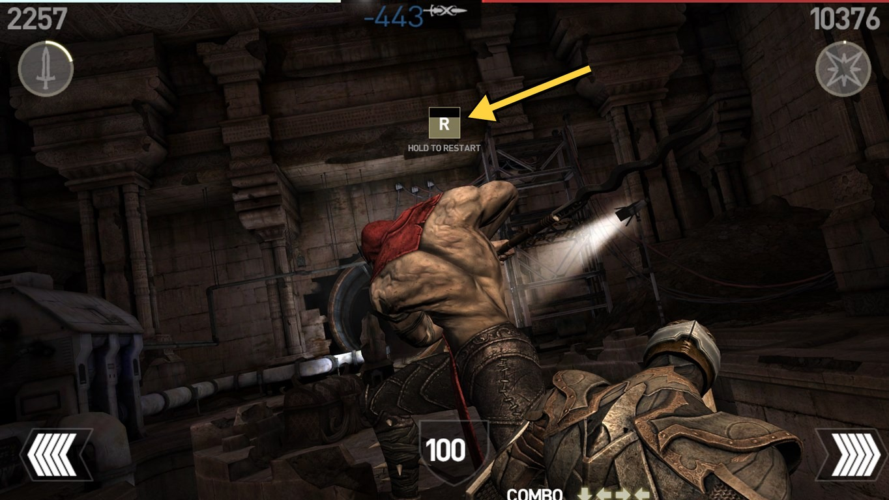
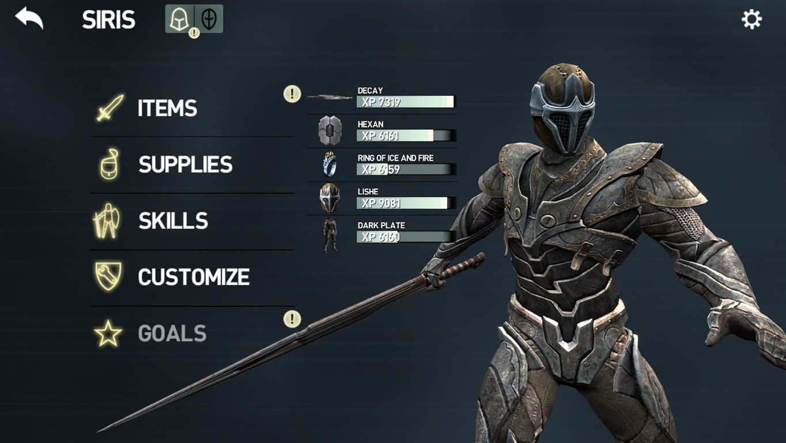
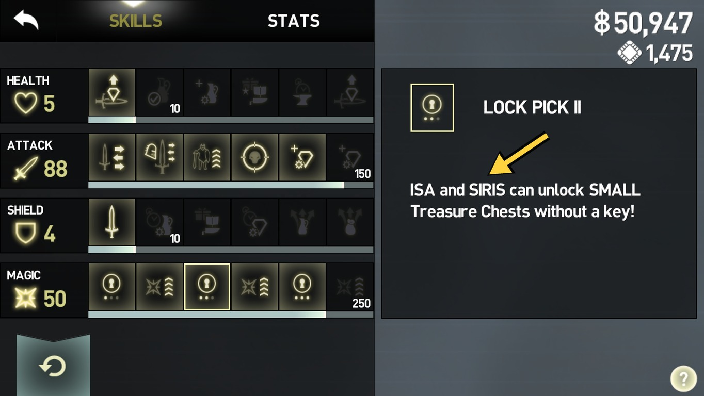
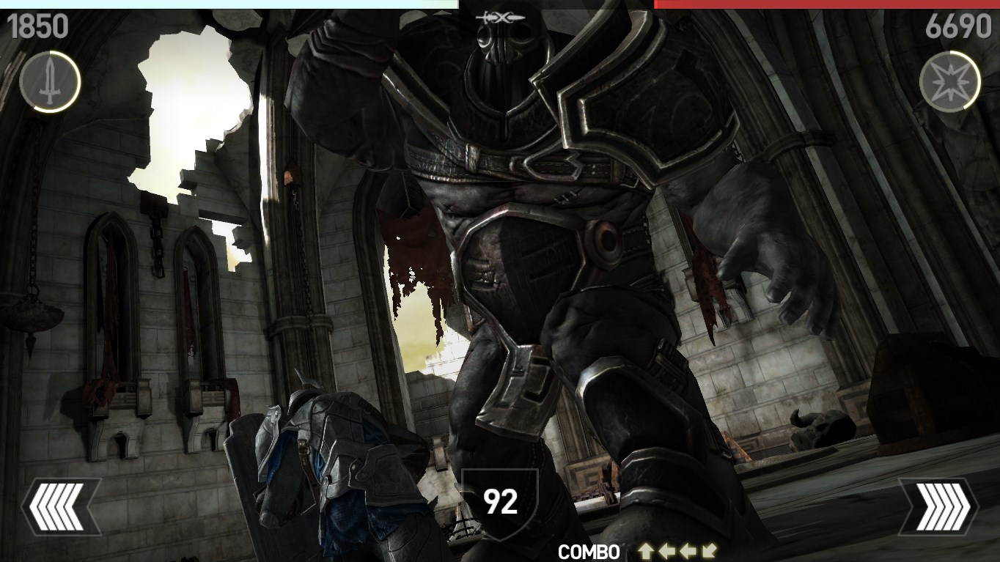
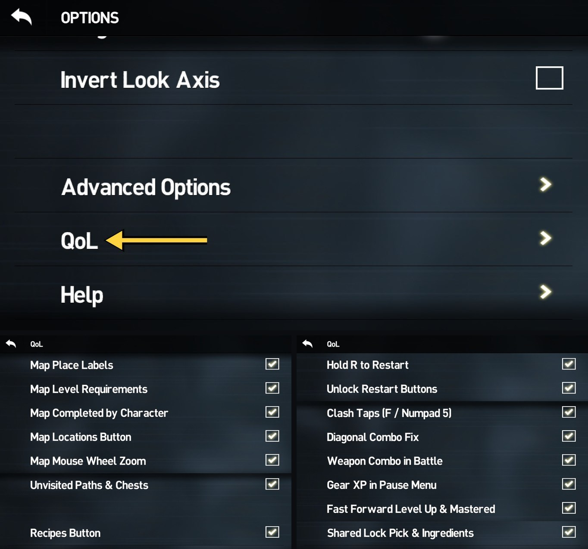

# Infinity Blade III PC – QoL mod

QoL Mod for Infinity Blade III. Compatible with the Community Patch.

## Install

1. Download **`dinput8.dll`** with the green button above.
2. Put it in `InfinityBlade3_v1.0.0\Binaries\Win64` (next to `IB3.exe`).
3. Play.

To uninstall, delete `dinput8.dll` (and the `IB3QoL` files it creates next to it). No game files or saves are changed.

**Steam Deck / Linux:** add `WINEDLLOVERRIDES="dinput8=n,b" %command%` to the launch options.

## Features

- **World map:** I hated the game's default map: I never knew or remembered what I had already played, where I was, or what I had missed. This fixes that. Every place on the globe gets a label, and the **LOCATIONS** button at the top of the map lists them all with the same labels, right under it. What they mean:
  - **NEW**: you have never been there.
  - **VISITED**: you went in but haven't finished it yet.
  - **COMPLETED** with a check on Siris's or Isa's icon: that character has finished it.
  - **COMPLETED** with an X on an icon: that character can still do it but hasn't yet. A character who can't play the place, or can't do it again, gets no icon.
  - **?**: the mod didn't see who finished it (for example, it was before you installed the mod) and the game's save doesn't say. On a character's icon it means that character may or may not have done it.

  When an act or interlude turns into an **EXPLORE** on the same pin, the explore keeps the character marks instead of showing up as **NEW**.

  

- **Mouse scroll on the map:** scroll the mouse wheel to zoom the globe in and out.

- **"!" on new paths and chests:** path circles and treasure chests you have never taken get the game's own **!** badge, so you can see which routes you haven't tried yet. Each save slot and each playthrough keeps its own marks.

  

- **Gem Cutter & Potion Master:** I didn't want to keep going online to look up how to make each recipe, so now it's all in the game: a **RECIPES** button with every recipe, using the game's icons. It covers rare gems and their level-ups, the rare defense gem (5% to 100%), Great Parry, Boss Boost and the Rare Darkfire gem's level-up. Click a result to see what it does. The Potion Master also lists the wiki's potion mixes with their odds, and what each ingredient is good for.

  

- **Quick restart for any fight, including the ones the game normally won't let you restart (super bosses, story fights):** hold **R** for 0.3 s during a fight or on the defeat screen. It's faster than the game's restart: you go straight back into the fight without tapping the enemy (for fights you start from a circle, except key circles). A small **R** tile shows only while you hold it. It also works during your death scene after a super boss (like Therin) kills you, until the rebirth starts. Not available in Hardcore, arena runs, ClashMob, hideout training, the Collector's fight, after you beat the boss, or against random dragons (a restart would make the dragon disappear).

  

- **Gear XP in the pause menu:** **click any item to open it straight in ITEMS** (outside a fight). The list shows the XP bar, or MASTERED, of everything you have equipped, the same list the game shows after a fight, right next to your character.

  

- **Shared skills:** **LOCK PICK II**, **LOCK PICK III** (Isa) and **INGREDIENT PLUS** (Siris) work for both characters once the character they belong to has unlocked them. Their description in the skill tree names both characters.

  

- **Sword clash taps on the keyboard:** when blades lock in a parry clash and the game asks you to tap fast, press **F** or **Numpad 5** instead of clicking. Outside a clash the mod does nothing with them (F keeps the game's own weak-point stab).

- **Weapon combo in battle:** your weapon's special combo (the same COMBO arrows the pause menu shows) stays on screen during fights, just right of the block button, also during a super attack.

  

- **Specific weapon combos (bug fix):** some weapons, like Snikt, have combos with diagonal arrows that almost never registered. Now they do.

- **Fast forward mastered and level up animations:** click, or hold **Left Shift** (the game's own fast-forward key), to skip the LEVEL UP / MASTERED animation. Left Shift also fast-forwards the battle results. Only the animation is skipped: your stat points and XP are already given.

- **Compatible with the Community Patch, and crash-proof for future game versions.** I think :P

- **QoL settings in the game:** you can turn any feature on and off in the options menu.

  
