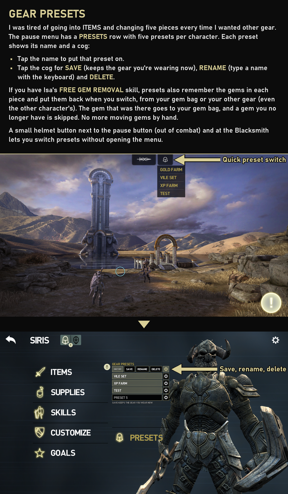
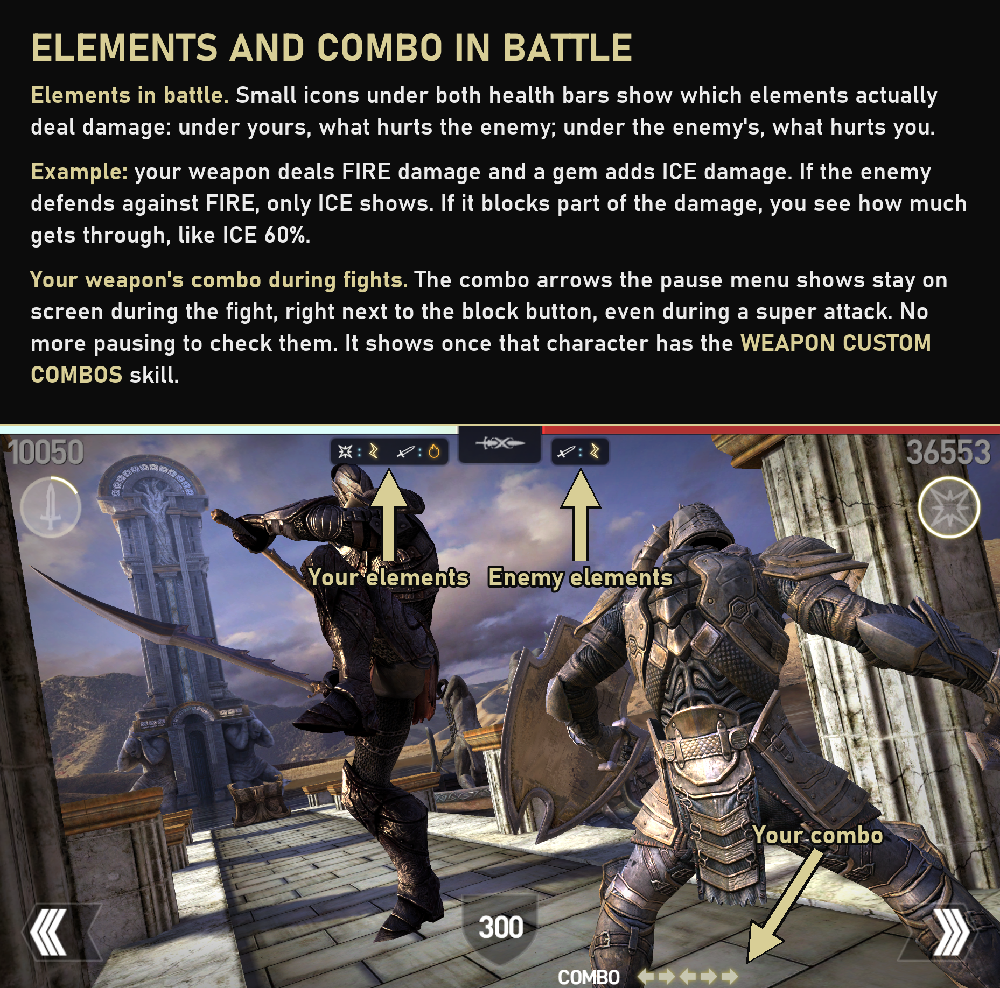
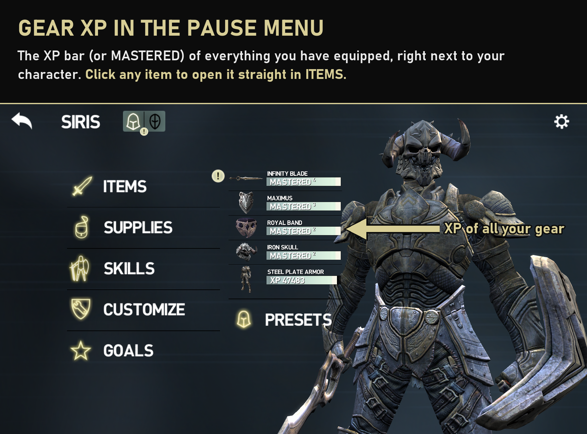
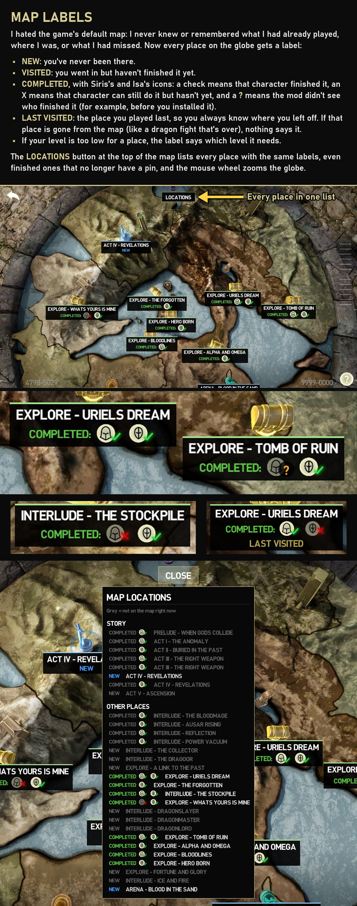
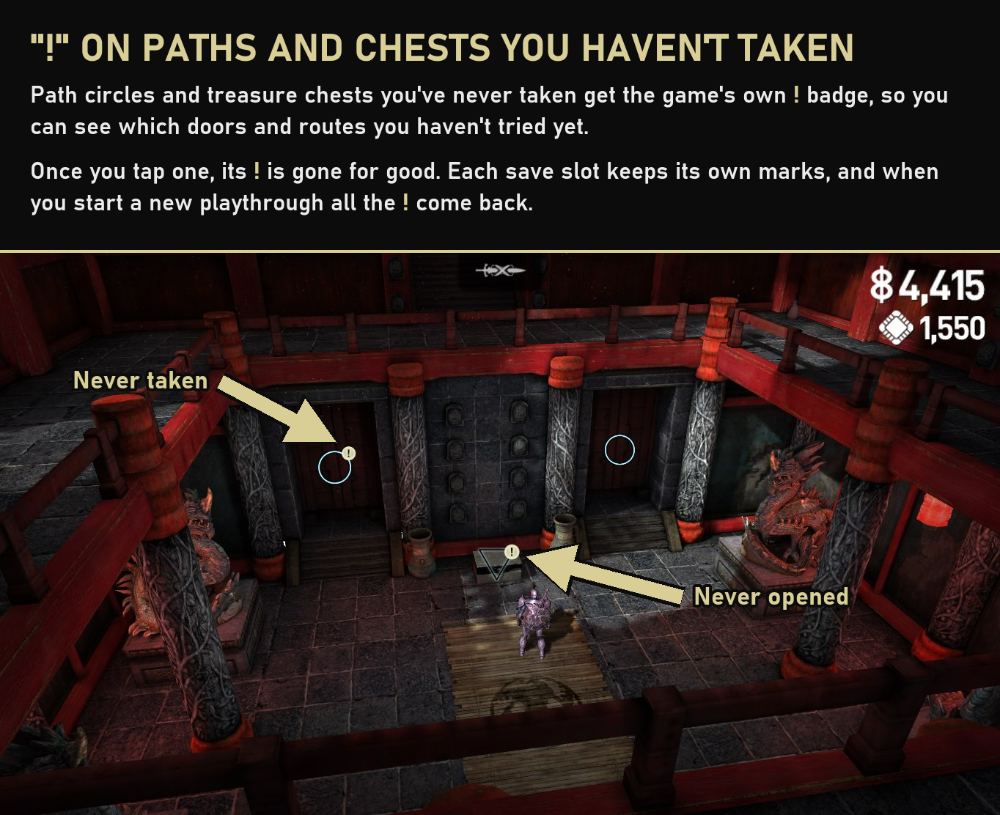
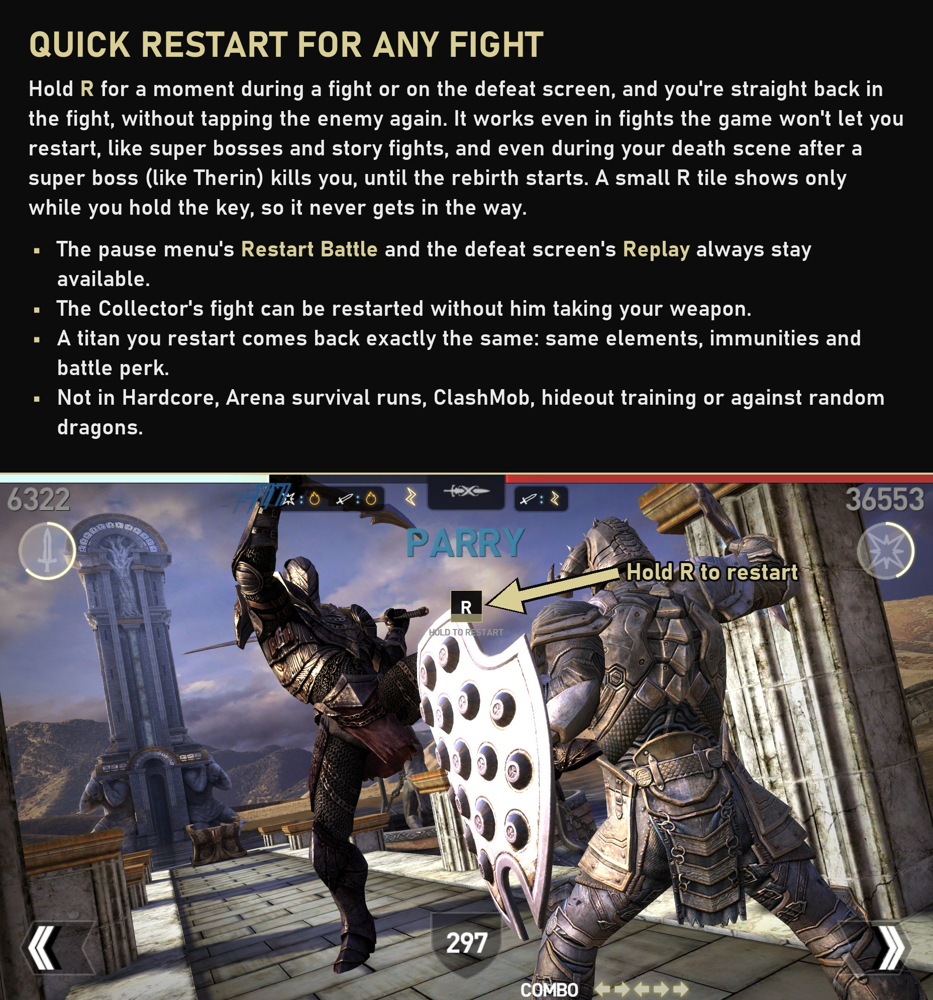
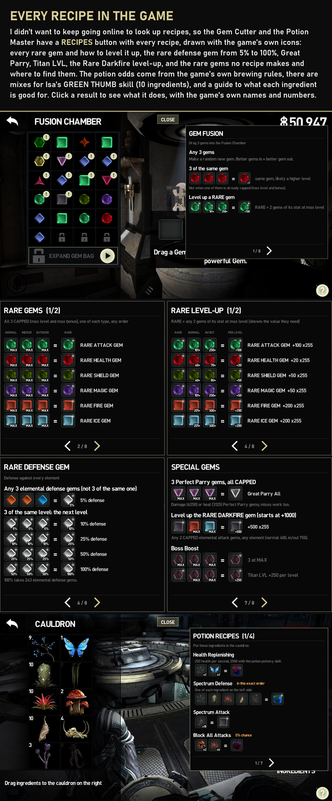
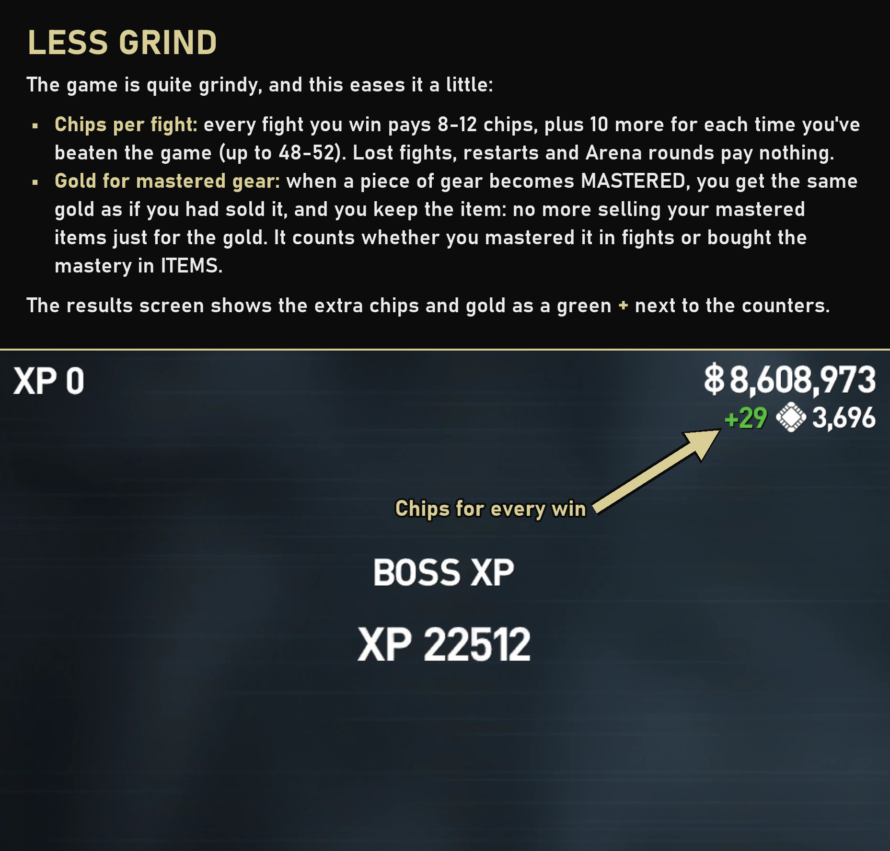
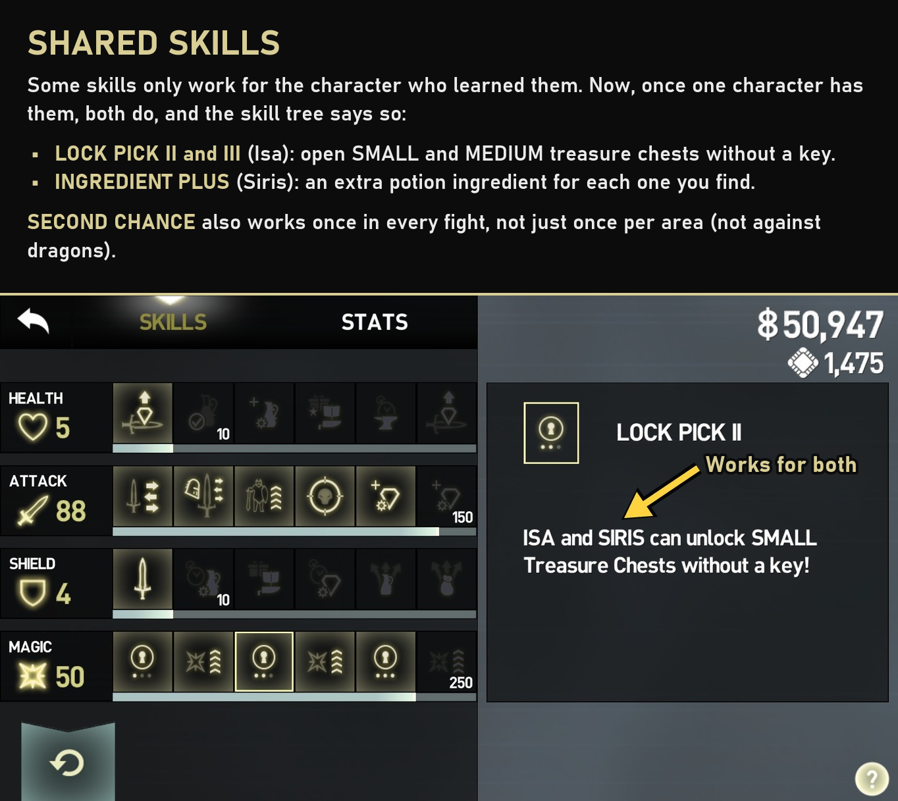
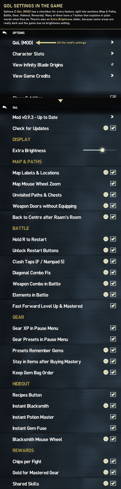

# Infinity Blade III PC – QoL mod

QoL Mod for Infinity Blade III. Compatible with the Community Patch. Everything is drawn with the game's own fonts, icons and menus, so it looks like part of the game, and you can turn every feature on and off in the game's own options menu.

 

## Install

1. Download **`dinput8.dll`** with the green button above.
2. Put it in `InfinityBlade3_v1.0.0\Binaries\Win64` (next to `IB3.exe`).
3. Play.

**Uninstall:** delete `dinput8.dll` (and `dinput8.dll.old` if it's there, and the `IB3QoL` files it creates next to it). No game files or saves are changed.

**Steam Deck / Linux:** add `WINEDLLOVERRIDES="dinput8=n,b" %command%` to the launch options.

## Features

**1. Gear presets**

**2. Elements and combo in battle**

**3. Gear XP in the pause menu**

**4. Map labels**

**5. "!" on paths and chests you haven't taken**

**6. Quick restart for any fight**

**7. Every recipe in the game**

**8. Less grind**

**9. Shared skills**

**10. QoL settings in the game**

## More features

**11. Weapon doors without equipping.** Some doors only open with a certain weapon, like Raam's and Cuttle's in Isa's room with four doors in the Seccian Desert. Normally you have to go to ITEMS and equip it first. With the mod, having the weapon in your inventory is enough: the door just opens. It doesn't apply to the saber door before Ryth, or to doors where the game makes you keep that weapon equipped afterward.

**12. Back to the centre after Raam's room.** In that same room, Raam's door leads to a side room with a titan and a chest, and after it the game walks you on to the next titan, so Cuttle's door (the one that leaves for the Canyon) is lost for that run. With the mod you come back to the room's centre with Cuttle's door still there, so you can do both doors in one run.

**13. Sword clash taps on the keyboard.** When blades lock in a sword clash and the game asks you to tap fast, press **F** or **Numpad 5** instead of clicking. They also work on the stab circles you tap again and again, like the dragon's eye after it bites you. Everywhere else the keys do what they did before.

**14. Diagonal combos fixed.** Some weapon combos have diagonal steps, like up-left (Snikt has them). The game only counted a fairly flat diagonal swipe, so a steeper one counted as straight up or down and broke the combo. Now steeper diagonals count too, and with the default keys Numpad 7 and Numpad 3 work for those steps as well.

**15. Boss battle themes fixed.** Some bosses have their own battle theme, but the game only plays it the first time and then never again. Now the Collector, Lelindre and Ausar get theirs in every fight, and Therin gets the Arena theme. The dragon theme also stays in dragon fights instead of now and then playing in a normal one.

**16. Fast forward the mastered and level up animations.** Click, or hold **Left Shift** (the game's own fast-forward key). Left Shift also fast-forwards the battle results. Your stat points and XP are already given, only the animation is skipped.

**17. Buy a mastery and stay in ITEMS.** Buying a mastery with chips (the chips button on the XP bar) plays MASTERED right there and leaves you in ITEMS, on the same tab and item, instead of sending you to the skills page.

**18. The gem bag keeps its order.** Each gem stays in the slot you put it in, in ITEMS and at the Gem Cutter, instead of the game sorting the bag by value every time it opens.

**19. Instant Blacksmith, Gem Fusion and Potion Master.** Whatever you put in the Blacksmith's forge, the Potion Master's cauldron or the Gem Cutter is ready right away (you still pay for it). The **UPGRADE** button at the Blacksmith levels the item up on the spot, even gear you're wearing, and keeps you in the same list. If the forge is full, finished items are picked up first to make room. The mouse wheel scrolls the Blacksmith's list too.

**20. Updates from inside the game.** The top row of Options → QoL (MOD) shows your version. Each time the game starts, the mod asks GitHub if there's a newer one. Nothing downloads until you tap that row and say yes; the new version then starts the next time you open the game (the old one stays next to it as `dinput8.dll.old`). If you don't want the mod to go online, turn off **Check for Updates** and it never connects to the internet.

**Crash-proof for future game versions.** I think :P

If something goes wrong, the mod writes a log to `Binaries\Win64\IB3QoL.log`. Open an issue with it and I'll take a look.
